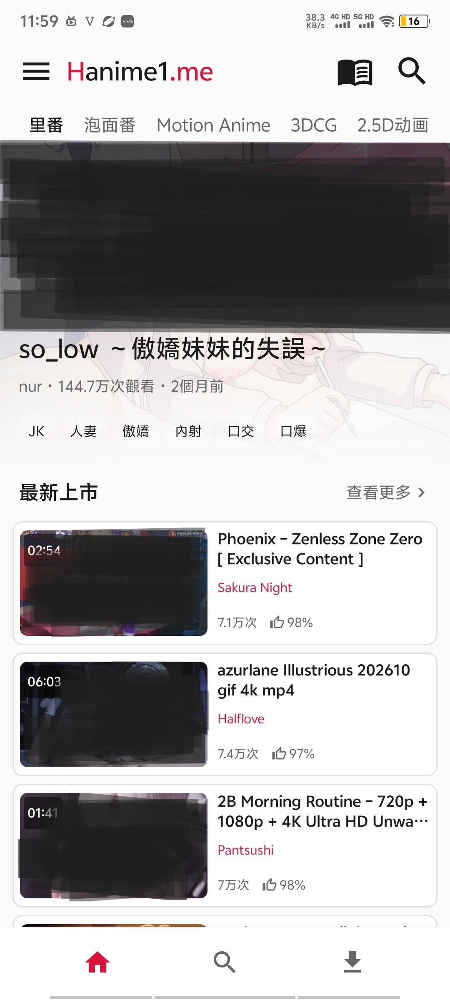
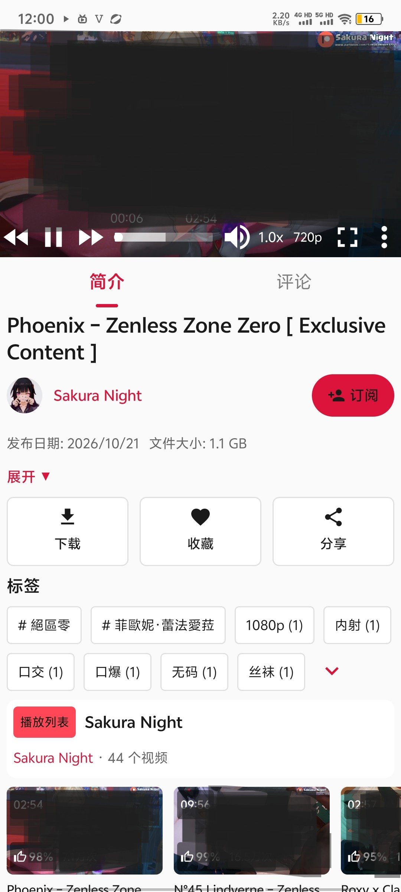
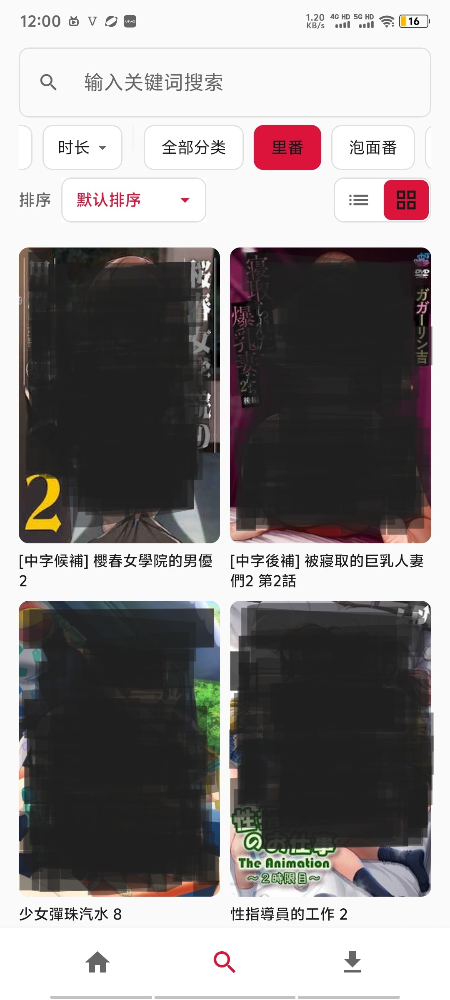
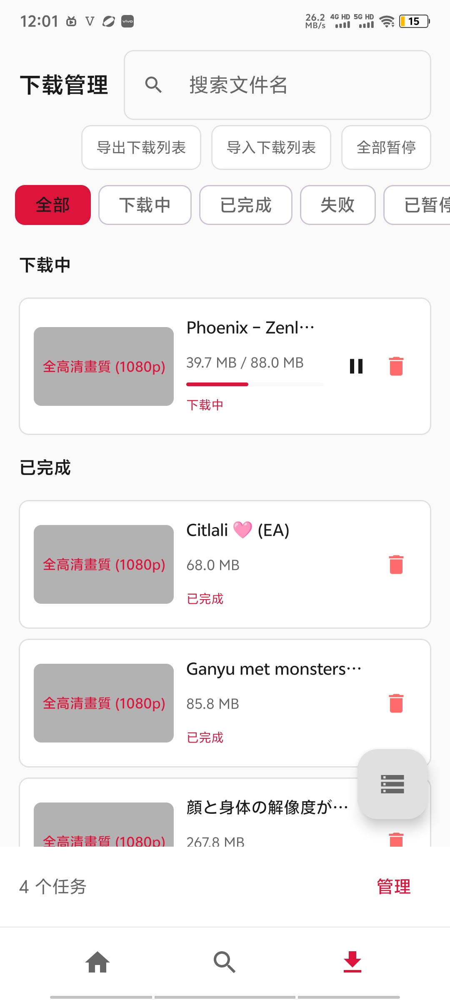
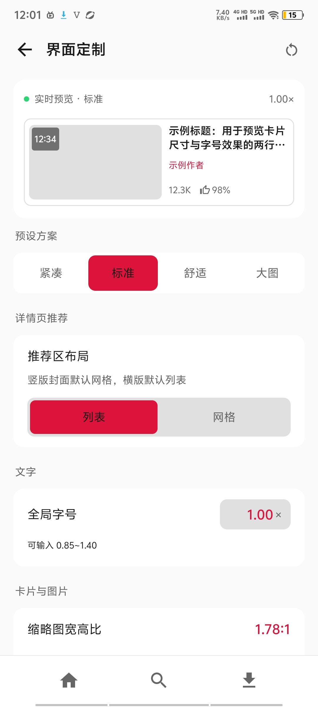
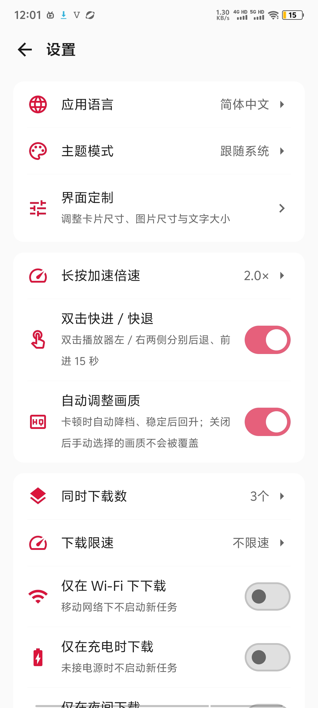
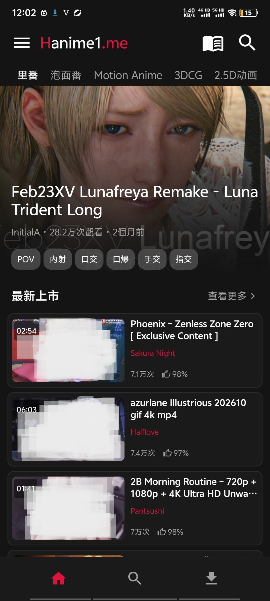

<p align="center">
  
</p>

<h1 align="center">Han1meAndroid</h1>

<p align="center">
  An unofficial Android client for Han1me, built with Jetpack Compose, MVVM + Repository and a multi-module architecture.
</p>

<p align="center">
  <a href="../../releases/latest"></a>
  <a href="../../actions/workflows/android-ci.yml"></a>
  <a href="LICENSE"></a>
  
</p>

<p align="center">
  <a href="README.md">简体中文</a> · <b>English</b>
</p>

## Download

**Latest: v1.7.1** · Android 11 (API 30) or newer · targets Android 17 (API 37)

| Item | Detail |
| --- | --- |
| Download | [GitHub Releases](https://github.com/Amisles/Han1meAndroid/releases/latest) |
| Package | `Han1meAndroid-v<version>.apk`, about 6 MB |
| Distribution | GitHub Releases only; not published on any app store |
| Upgrading | Install over the existing app with the same signature; favorites, history and downloads are kept |

> The app needs network access to the corresponding site. If the default site is unreachable, configure a working mirror under Settings → Site URL.

## Screenshots

<p align="center">
  
  
  
  
</p>

<p align="center">
  
  
  
</p>

## Features

- **Home and discovery**: multi-section home feed, pull-to-refresh, error retry
- **Search and filters**: keyword / category / sort, freely combinable, plus tag, date and duration filters; search history kept locally (up to 20 entries)
- **Streaming**: multi-quality HLS playback, full screen, speed control, picture-in-picture, background playback, double-tap seek, pinch to zoom
- **Offline downloads**: background downloads via a foreground service, resumable chunked multi-connection engine, concurrency control, batch selection and multi-task downloads
- **Favorites and history**: stored locally with Room, automatic de-duplication
- **Account**: login with encrypted cookie storage (EncryptedSharedPreferences), profile editing (nickname, email)
- **Community**: video comments with threaded replies and like counts, author pages (stats, videos, playlists), one-tap subscribe
- **Playlists**: browse public playlists, add a whole playlist to the download queue
- **Personalization**: four languages (简体中文 / 繁體中文 / English / 日本語) with instant switching, light / dark / system theme, Material 3 dynamic color
- **UI customization**: global font scale, thumbnail aspect ratio and corner radius, list thumbnail width, grid columns and target column width, image decode quality, items per home section; per-section layout (list / grid / horizontal) and ordering; four presets; configuration import and export as text
- **Network diagnostics**: DNS, connectivity, certificate, mirror and login state checks
- **Tablet support**: responsive navigation rail, grid and typography
- **"My" drawer**: account, subscriptions and settings gathered into a side drawer from the home top bar
- **Architecture**: Hilt dependency injection, constructor-injected ViewModels

## Tech stack

| Area | Technology | Version |
| --- | --- | --- |
| Build | Android Gradle Plugin | 9.4.1 |
| Language | Kotlin | 2.4.21 |
| UI | Jetpack Compose BOM | 2026.09.00 |
| Design | Material 3 (Compose) | via BOM |
| Architecture | MVVM + Repository + unidirectional data flow | - |
| DI | Hilt (Dagger) | 2.60.1 |
| Navigation | Navigation Compose | 2.10.2 |
| Hilt navigation | Hilt Navigation Compose | 1.4.0 |
| Lifecycle | Lifecycle + ViewModel Compose | 2.11.0 |
| Coroutines | Kotlin Coroutines / Flow / StateFlow | via Kotlin |
| Networking | OkHttp | 5.5.0 |
| HTML parsing | Jsoup | 1.23.2 |
| Images | Coil 3 (OkHttp network stack) | 3.6.3 |
| Video | Media3 ExoPlayer (with HLS) | 1.11.1 |
| Persistence | Room + KSP | 2.8.5 |
| Key-value storage | EncryptedSharedPreferences + DataStore-style Flow wrapper | - |
| Secure storage | AndroidX Security (EncryptedSharedPreferences) | 1.1.0 |
| Symbol processing | KSP | 2.3.12 |
| Activity | Activity Compose | 1.13.0 |
| Core | AndroidX Core KTX | 1.19.1 |
| minSdk | Android 11 (API 30) | - |
| targetSdk | Android 17 (API 37) | - |

## Project structure

```
hanime/
|-- app/                        # Application module
|   |-- HanimeApplication.kt    # @HiltAndroidApp entry, LocaleHelper wrapping
|   |-- MainActivity.kt         # @AndroidEntryPoint, NavHost, edge-to-edge
|   |-- service/                # DownloadService (foreground download notification)
|   |-- ui/
|   |   |-- theme/              # HanimeTheme (MD3 color scheme, typography, press feedback)
|   |   |-- components/         # BottomNav (transparent touch interceptor)
|   |   |-- screens/            # Shared screens (playlist, video list)
|   |   `-- viewmodel/          # Shared ViewModels
|   `-- res/                    # App resources (icons, notification channel, FileProvider)
|
|-- core/                       # Foundation layer (pure Android library, no business logic)
|   |-- common/                 # AppLogger, LocaleHelper, extensions
|   `-- ui/                     # Shared UI: MD3 palette, strings in 4 languages, design tokens
|                               #   (UiConfig / UiConfigStore / UiPreset / HomeSectionConfig),
|                               #   window info, shared components (cards, thumbnails, settings groups)
|
|-- data/                       # Data layer (single source of truth)
|   |-- cookie/                 # HCookieJar (thread-safe, expiry cleanup)
|   |-- di/                     # DatabaseModule (Room DB/DAO via Hilt)
|   |-- download/               # DownloadManager (chunked multi-connection, gating, bitmap resume, connection rebuild)
|   |-- local/                  # Room database: AppDatabase, DAOs, entities, migrations
|   |-- parser/                 # HTML parsers (home / search / detail / download / playlist / author / subscription / comment / account)
|   |-- preferences/            # Preferences (SharedPreferences + StateFlow)
|   |-- remote/                 # NetworkService (OkHttp + Hilt singleton + HCookieJar)
|   `-- repository/             # HanimeRepository (coroutine IO dispatch, result wrapping)
|
|-- domain/
|   `-- model/                  # Domain models: plain data classes, no Android dependencies
|
`-- feature/                    # Feature modules (Screen + ViewModel each)
    |-- home/                   # Home feed
    |-- search/                 # Search and filters
    |-- detail/                 # Video detail + ExoPlayer
    |-- download/               # Download manager and batch selection
    |-- profile/                # Profile, login, favorites, history, subscriptions
    `-- settings/               # Settings, customization, diagnostics, about, author page
```

## Architecture

### MVVM with unidirectional data flow

```
View (Compose) --> ViewModel (StateFlow) --> Repository --> NetworkService / Database
```

- **View**: declarative Compose UI, subscribing through `collectAsStateWithLifecycle`
- **ViewModel**: owns `StateFlow` / `MutableStateFlow`, runs business logic, performs network work on `Dispatchers.IO`
- **Repository**: single source of truth across network and local database
- **Model**: plain data classes defined in `:domain:model`

### Modularization

The project is split into 11 Gradle modules with one-way dependencies:

```
feature-* --> core:ui --> core:common
    |             |
    v             v
  data ------> domain:model
```

## Build and run

### Requirements

- JDK 21 (required by AGP 9.x; source compatibility is Java 11)
- Android Studio with AGP 9.x support
- Kotlin 2.4.21

### Commands

```bash
# Debug build
./gradlew assembleDebug

# Release build
./gradlew assembleRelease

# Unit tests
./gradlew test
```

---

## Contributing and support

Feedback, feature suggestions and pull requests are all welcome.

### Reporting issues

- Search [existing issues](../../issues) first to avoid duplicates
- Pick the matching issue template and include:
  - Steps to reproduce, expected and actual behavior
  - App version, Android version and device model
  - Relevant logs (at `filesDir/hanime_app.log`) or screenshots
- For non-public or security-related reports, use a [Security Advisory](../../security/advisories/new)

### Sending pull requests

1. Fork the repository and create a branch: `git checkout -b feat/your-feature` or `fix/your-bugfix`
2. Follow the existing code style and the MVVM + multi-module conventions
3. If the change touches networking or parsing, add or update unit tests
4. Prefer Conventional Commit titles (`feat:` / `fix:` / `docs:` / `refactor:` …)
5. Link the related issue and describe what changed and how you tested it
6. Wait for review and push follow-up commits to the same branch

### Supporting the project

If this project helps you, a star means a lot.

You can also help by:

- Opening issues with concrete suggestions
- Translating or proofreading the four locales (Simplified Chinese / Traditional Chinese / English / Japanese)
- Sending pull requests for bugs and features

---

## License

Licensed under the [GNU General Public License v3.0](LICENSE).

You are free to use, study, modify and redistribute this software. If you distribute it or a derivative work, you must also release the complete source under GPLv3 and keep the original copyright notice and license text.

## Acknowledgements

Built with these open source projects:

- [Android Gradle Plugin](https://developer.android.com/build/releases/gradle-plugin) - Apache 2.0
- [Kotlin](https://kotlinlang.org) - Apache 2.0
- [Jetpack Compose](https://developer.android.com/jetpack/compose) - Apache 2.0
- [Media3 ExoPlayer](https://developer.android.com/media/media3) - Apache 2.0
- [OkHttp](https://square.github.io/okhttp) - Apache 2.0
- [Jsoup](https://jsoup.org) - MIT
- [Coil 3](https://coil-kt.github.io/coil) - Apache 2.0
- [Room](https://developer.android.com/jetpack/androidx/releases/room) - Apache 2.0
- [Navigation Compose](https://developer.android.com/jetpack/compose/navigation) - Apache 2.0
- [Lifecycle](https://developer.android.com/jetpack/androidx/releases/lifecycle) - Apache 2.0
- [KSP](https://kotlinlang.org/docs/ksp-overview.html) - Apache 2.0

## Disclaimer

This project is for learning and research only. It does not host any video content; all content comes from third-party websites. Use it at your own risk. The author is not liable for any direct or indirect loss caused by using this software. Please comply with local laws and regulations.
